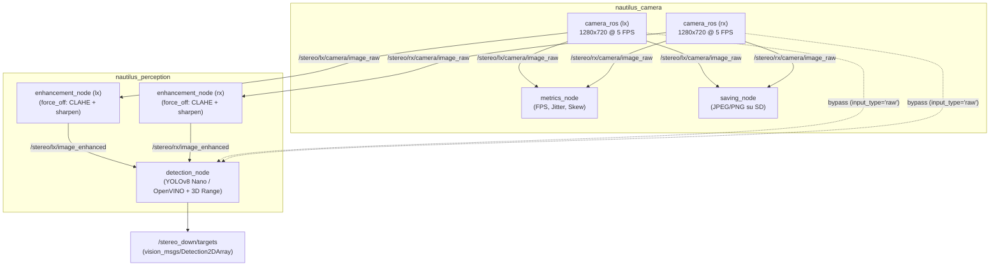

# Nautilus Edge Perception & Vision Benchmark

Pipeline di computer vision edge basata su **ROS 2 (Jazzy)** e accelerata tramite **Intel OpenVINO**, progettata e ottimizzata per l'hardware di bordo (**Raspberry Pi 5**) del modulo fototrappola stereoscopica subacquea nell'ambito del progetto **Nautilus** (Università degli Studi di Padova).

Il progetto è dedicato all'esplorazione autonoma, al monitoraggio dell'ambiente marino e al rilievo di flora e fauna, operando in condizioni critiche di risorse computazionali ristrette, alimentazione a batteria e assenza di dissipazione attiva (camera stagna chiusa, stress termico).

---

## 🧭 Indice della Documentazione e Mappa della Repository

Indice unificato per navigare direttamente in tutta la documentazione, i pacchetti ROS 2 e i moduli presenti nel repository.

### 📄 Documentazione Generale (`docs/`)

* **[Guida al Lancio Globale](docs/global_launch.md)** — Architettura del sistema di lancio, routing automatico dei topic, gestione delle variabili d'ambiente, service systemd (`nautilus-vision.service`, `lock-cameras.service`) e comandi di test.
* **[Roadmap Operativa](docs/TODO.md)** — Tabella di marcia suddivisa in 9 fasi (Acquisizione, Enhancement, Salvataggio, Detection, Calibrazione 720p, Benchmark, Stress test termico, Integrazione, Documentazione).
* **[Setup Hardware Pi Camera v3](docs/setup-picam3.md)** — Configurazione del Raspberry Pi 5 con Ubuntu Server 24.04, build di `libcamera` da sorgente per il pipeline handler `pisp`, installazione di `rpicam-apps` e `picamera2`, fix noti (`libcap-dev`, `pykms`, symlink `site-packages`).
* **[Export OpenVINO](docs/ov_export.md)** — Procedura di export YOLOv8n e `best.pt` in FP32/INT8, gestione dataset di calibrazione, verifica shape e test `imgsz`.
* **[Cheat-Sheet Comandi ROS 2](docs/ros2-cmds.md)** — Raccolta di comandi essenziali per build (`colcon`), launch, ispezione nodi/topic e registrazione bag.
* **[Dipendenze Raspberry Pi](docs/requirements_pi.txt)** — Elenco dei pacchetti Python e di sistema per l'ambiente Pi.
* **[Dipendenze Virtual Environment](docs/requirements_venv.txt)** — Pacchetti Python per il venv di sviluppo (export OpenVINO, calibrazione, benchmark).

### 📦 Workspace e Pacchetti ROS 2 (`ros2_ws/`)

* **[Workspace Overview](ros2_ws/README.md)** — Struttura generale del workspace, istruzioni di build e configurazione CycloneDDS.
* **[Package `nautilus_common`](ros2_ws/src/nautilus_common/README.md)** — Utility condivise, costanti e profili QoS centralizzati per garantire l'allineamento della comunicazione DDS tra tutti i nodi (sia Python che C++).
* **[Package `nautilus_camera`](ros2_ws/src/nautilus_camera/README.md)** — Acquisizione hardware 720p @ 5 FPS, nodo di benchmark (`metrics_node`), nodo di salvataggio immagini su MicroSD (`saving_node`) con gestione crash e assenza RTC. Configurazione centralizzata in `nautilus_camera.yaml`.
* **[Package `nautilus_perception`](ros2_ws/src/nautilus_perception/README.md)** — Modulo core di elaborazione visiva: nodo di enhancement (WaterNet/CLAHE, default `force_off`) e nodo di detection IA + stereovisione.
  * **[Sottomodulo Detection](ros2_ws/src/nautilus_perception/nautilus_perception/detection/README.md)** — Dettagli su architettura *Detect-Then-Range*, calibrazione stereo ChArUco e matching epipolare.
  * **[Debug & Status](ros2_ws/src/nautilus_perception/nautilus_perception/detection/DEBUG.md)** — Problemi noti/risolti, lock fotometrico (`lock_cameras.py`), workflow operativo e checklist di stato del modulo.
* **[Package `nautilus_msgs`](ros2_ws/src/nautilus_msgs/README.md)** — Definizioni delle interfacce e dei messaggi custom della suite Nautilus.
* **[Driver `camera_ros`](ros2_ws/src/camera_ros/README.md)** — Driver ROS 2 per `libcamera`, integrato per il controllo diretto dei doppi sensori CSI Pi Camera v3.

### ⚙️ Script di Gestione e Deployment (`deploy/`) & Configurazione

* **[Script Avvio Pipeline](deploy/start_pipeline.sh)** — Entry point di boot invocato da systemd: avvia **solo** acquisizione + salvataggio opzionale. Enhancement, detection e metriche non partono mai automaticamente.
* **[Servizio Systemd Pipeline](deploy/nautilus-vision.service)** — Unit file per l'avvio automatico al boot (trigger reed switch).
* **[Servizio Systemd Lock Cameras](deploy/lock-cameras.service)** — Unit file che lancia `lock_cameras.py` subito dopo l'avvio delle camere per riapplicare i parametri fotometrici.
* **[Script Lock Fotometrico](deploy/lock_cameras.py)** — Rilegge `nautilus_camera.yaml` e riapplica lens position, autofocus, exposure e colour gains via `set_parameters`. Necessario perché `camera_ros` rifiuta `AfMode`/`LensPosition` su IMX708 al boot.
* **[Configurazione Ambiente](pipeline_config.env)** — Unico flag: `ENABLE_SAVING` (true/false). Enhancement, detection e metriche si lanciano sempre a mano.
* **[Configurazione CycloneDDS](deploy/cyclonedds.xml)** — Profilo DDS usato da tutti i nodi per la comunicazione su rete.
* **[Disabilitazione WiFi Power Save](deploy/wifi-powersave-off.service)** — Unit systemd opzionale per ridurre jitter di rete.

### 📊 Benchmark & Validation (`benchmarks/`)

* **[Benchmark Overview](benchmarks/README.md)** — Metodologia dei test prestazionali e termici (Fase 6 e 7), configurazioni di pipeline, metriche raccolte (latenza p50/p95, CPU, RAM, temperatura, mAP) e linee guida di riproducibilità.
* **[Configurazioni di Test](benchmarks/CONFIGS.md)** — 11 config di test (Fase A: 6 config senza OC; Fase B: 5 config con OC), con modello/half_res/imgsz, prerequisiti, valori attesi e comandi batch per i run.
* **[Script di Lancio](benchmarks/)** — `run_benchmark.sh`.
* **[Script di Benchmark](benchmarks/scripts/)** — `benchmark_pipeline.py`, `system_monitor.py`, `evaluate_map.py`, `plot_results.py`, `model_benchmark.py`, `check_imgsz.py`.
* **[Dataset di Test](benchmarks/datasets/)** — Immagini e video stereo di test, dataset grezzi annotati, dataset COCO128 per mAP e tool di pulizia (`clean_dataset.py`).
* **[Risultati](benchmarks/results/)** — CSV temporizzati (`csv/`) e grafici PNG (`plots/`) prodotti durante le sessioni.

### 🐳 Containerizzazione (`docker/`)

* **[Dockerfile](docker/Dockerfile)** — Immagine Docker per il deploy riproducibile della pipeline.
* **[Docker Compose](docker/docker-compose.yaml)** — Orchestrazione del container con volumi e rete.

### 🏛️ Archivio Storico e Componenti Legacy

* **[Sensing Rigs Daemon](sensing-rigs-daemon/README.md)** — Codice sorgente del vecchio demone di acquisizione in C a basso livello.
  * **[Benchmark MicroSD](sensing-rigs-daemon/microsd_benchmark.md)** — Analisi di throughput su schede MicroSD Kingston Canvas Select Plus.
  * **[Ottimizzazione FPS](sensing-rigs-daemon/fps_optimization_summary.md)** — Studio sui colli di bottiglia e latenze del demone legacy.
  * **[TODO Legacy Daemon](sensing-rigs-daemon/TODO.md)** — Obiettivi di sviluppo del vecchio demone.

---

## 🏗️ Architettura dei Nodi della Pipeline

L'architettura della visione stereoscopica è organizzata in 4 nodi distribuiti su 2 pacchetti principali.



1. **Nodo 1 — Acquisizione (`camera_ros`, package `nautilus_camera`):**
   * Gestisce in contemporanea le due telecamere Pi Camera v3 su bus CSI.
   * Risoluzione forzata a **720p (1280×720)** e framerate calibrato a **5 FPS** (`FrameDurationLimits: [200000, 200000]`).
   * **È l'unico nodo che parte automaticamente al boot**, tramite `nautilus-vision.service`.
   * Include il nodo diagnostico [`metrics_node`](ros2_ws/src/nautilus_camera/nautilus_camera/metrics_node.py) per monitorare FPS effettivi, jitter e skew stereo (~1.5 ms). **Non parte mai automaticamente**: si lancia a mano durante i test.

2. **Nodo 2 — Salvataggio (`saving_node`, package `nautilus_camera`):**
   * Salva le coppie di frame stereo su MicroSD con naming incrementale ordinabile (`nautilus_lx_00000001.jpg`).
   * Supporta isolamento delle sessioni con protezione automatica da sovrascrittura in caso di orologio di sistema non sincronizzato (assenza RTC).
   * Esegue `os.sync()` regolabile tramite parametro `flush_every_n` per evitare la perdita di file in caso di spegnimento immediato da reed switch.
   * Controllabile dinamicamente a runtime tramite servizio ROS 2 `~/set_saving` (`std_srvs/srv/SetBool`).
   * **Parte al boot solo se `ENABLE_SAVING=true`** in `pipeline_config.env`.

3. **Nodo 3 — Enhancement (`enhancement_node`, package `nautilus_perception`):**
   * Applica algoritmi di miglioramento del contrasto e bilanciamento cromatico subacqueo su entrambi i flussi stereo.
   * Modalità configurabile tramite parametro `waternet_mode`:
     * **`force_off` (default)**: disabilita WaterNet, esegue solo CLAHE + sharpening. È il default perché WaterNet è una rete neurale pensata per la post-produzione delle immagini destinate ai biologi, **non per la navigazione né la detection**. Su Raspberry Pi la latenza misurata è di ~70 s per frame, incompatibile con l'uso operativo.
     * **`auto`**: rileva l'hardware e attiva WaterNet solo se trova CUDA/MPS. Utile solo su workstation di sviluppo.
     * **`force_on`**: forza WaterNet anche su CPU. Solo per rigenerare immagini a posteriori.
   * Mantiene invariati i timestamp originali dell'header per non degradare la sincronizzazione stereo a valle.
   * **Non parte mai automaticamente**: si lancia a mano quando serve.

4. **Nodo 4 — Detection & Stereovisione (`detection_node`, package `nautilus_perception`):**
   * Architettura **Detect-Then-Range**: esegue l'inferenza IA (YOLOv8n / OpenVINO) sul frame sinistro rettificato e campiona la disparità stereo epipolare per calcolare la distanza tridimensionale $Z$.
   * Supporta input commutabile sia da immagini grezze (`/stereo/{lx,rx}/camera/image_raw`) sia migliorate (`/stereo/{lx,rx}/image_enhanced`). Il routing è automatico in `pipeline.launch.py` in base a `enable_enhancement`.
   * Pubblica i target su `/stereo_down/targets` con coordinate 2D/3D in formato `vision_msgs/Detection2DArray`.
   * **Non parte mai automaticamente**: si lancia a mano quando serve.

---

## 🚀 Logica di Esecuzione e Lancio

La pipeline adotta una distinzione netta tra **cosa parte al boot** e **cosa si lancia a mano**.

### 1. Avvio automatico al boot (produzione)

* **Trigger hardware:** quando il robot viene acceso tramite magnete (interruttore reed switch), il sistema operativo avvia il servizio systemd [`nautilus-vision.service`](deploy/nautilus-vision.service).
* **Comportamento:** il servizio invoca [`start_pipeline.sh`](deploy/start_pipeline.sh), il quale legge `ENABLE_SAVING` da [`pipeline_config.env`](pipeline_config.env) e lancia [`stereo_camera.launch.py`](ros2_ws/src/nautilus_camera/launch/stereo_camera.launch.py):
  * **Acquisizione:** obbligatoria (`camera_ros` sempre attivi).
  * **Salvataggio:** opzionale, governato da `ENABLE_SAVING=true/false`.
  * **Metriche:** **mai** (forzato `enable_metrics:=false`).
* **Post-avvio:** [`lock-cameras.service`](deploy/lock-cameras.service) parte dopo `nautilus-vision.service` e invoca [`lock_cameras.py`](deploy/lock_cameras.py), che rilegge `nautilus_camera.yaml` e riapplica i parametri fotometrici via `set_parameters`.
* **Obiettivo:** zero consumo di risorse per modelli di deep learning pesanti all'avvio; batteria, RAM e termica sono riservate all'acquisizione scientifica.

### 2. Avvio manuale di enhancement e detection

Enhancement, detection e metriche si lanciano a mano, **sopra le camere già attive**. Il launch file [`pipeline.launch.py`](ros2_ws/src/nautilus_perception/launch/pipeline.launch.py) ha `include_stereo_camera:=false` di default: assume che le camere siano già su e non tenta di riavviarle.

```bash
# 1. Solo detection, input raw (nessun pre-processing)
ros2 launch nautilus_perception pipeline.launch.py \
    enable_detection:=true \
    enable_enhancement:=false

# 2. Enhancement (force_off) + detection
ros2 launch nautilus_perception pipeline.launch.py \
    enable_detection:=true \
    enable_enhancement:=true \
    waternet_mode:=force_off

# 3. Solo enhancement (raro, per debug visivo)
ros2 launch nautilus_perception pipeline.launch.py \
    enable_detection:=false \
    enable_enhancement:=true
```

Se invece vuoi partire da zero (es. su workstation con i service systemd fermi), passa `include_stereo_camera:=true` per far avviare anche le camere:

```bash
ros2 launch nautilus_perception pipeline.launch.py \
    include_stereo_camera:=true \
    enable_detection:=true \
    enable_enhancement:=false
```

**Attenzione:** se le camere sono già attive dal boot e lanci `stereo_camera.launch.py` di nuovo, ROS 2 va in errore per nodo duplicato. Questo è il motivo per cui `pipeline.launch.py` di default non le riavvia.

---

## 📊 Mappa Ufficiale dei Topic ROS 2

| Topic | Tipo Messaggio | Publisher | Subscriber Principale | Note |
| --- | --- | --- | --- | --- |
| `/stereo/lx/camera/image_raw` | `sensor_msgs/Image` | `camera_ros (lx)` | `metrics_node`, `saving_node`, `enhancement_node`, `detection_node` (se raw) | Frame grezzo 720p @ 5 FPS camera sinistra |
| `/stereo/rx/camera/image_raw` | `sensor_msgs/Image` | `camera_ros (rx)` | `metrics_node`, `saving_node`, `enhancement_node`, `detection_node` (se raw) | Frame grezzo 720p @ 5 FPS camera destra |
| `/stereo/lx/image_enhanced` | `sensor_msgs/Image` | `enhancement_node (lx)` | `detection_node` (se enhanced) | Immagine migliorata (CLAHE/WaterNet) sx |
| `/stereo/rx/image_enhanced` | `sensor_msgs/Image` | `enhancement_node (rx)` | `detection_node` (se enhanced) | Immagine migliorata (CLAHE/WaterNet) dx |
| `/stereo_down/targets` | `vision_msgs/Detection2DArray` | `detection_node` | Stack di controllo veicolo / Jetson | Bounding box 2D + stima distanza metrica Z |
| `/saving_node/set_saving` | `std_srvs/SetBool` *(Service)* | `saving_node` | Client esterno / operatore | Abilita/disabilita salvataggio a runtime |
| `/stereo/{lx,rx}/camera/set_parameters` | `rcl_interfaces/SetParameters` *(Service)* | `camera_ros` | `lock_cameras.py` | Riapplica parametri fotometrici via `lock_cameras.py` |

> **QoS dei topic**: i profili QoS effettivi di ogni topic (reliability,
> depth, durability) sono definiti in un'unica fonte di verità,
> `ros2_ws/src/nautilus_common/config/qos_overrides.yaml`. I nodi Python
> li leggono via `qos_profiles.py`, i nodi C++ via `--params-file`. Vedi
> [`nautilus_common/README.md`](ros2_ws/src/nautilus_common/README.md).
> Verifica sul campo: `ros2 topic info <topic> -v`.

---

## 🛠️ Stack Tecnologico e Requisiti

* **Target Hardware:** Raspberry Pi 5 (8 GB RAM) con doppi sensori Sony IMX708 (Pi Camera Module 3).
* **OS & Middleware:** Ubuntu 24.04 LTS a 64 bit con **ROS 2 Jazzy Jalisco**, Domain DDS configurato con **CycloneDDS** (`rmw_cyclonedds_cpp`).
* **Librerie Vision & AI:**
  * OpenCV 4.x (con binding Python e `cv_bridge`).
  * Intel OpenVINO 2024.x per inferenza accelerata su CPU ARM.
  * Ultralytics YOLOv8 (PyTorch, solo su workstation/export).
  * `libcamera` (fork Raspberry Pi) e `camera_ros`.
* **Python:** PyYAML (per `lock_cameras.py`).

Per il setup completo dell'ambiente Pi Camera su Ubuntu Server vedi [`docs/setup-picam3.md`](docs/setup-picam3.md).

---

## 💻 Compilazione e Setup del Workspace

```bash
# 1. Spostati nel workspace ROS 2
cd ~/nautilus-vision-pipeline/ros2_ws

# 2. Compila con supporto ai symlink (utile durante lo sviluppo)
colcon build --symlink-install

# 3. Source dell'ambiente
source install/setup.bash
```

Per i comandi più usati durante lo sviluppo vedi [`docs/ros2-cmds.md`](docs/ros2-cmds.md).

---

## 📈 Roadmap di Sviluppo (Allineamento con `docs/TODO.md`)

| Fase | Descrizione | Stato | Componenti Coinvolti |
| --- | --- | --- | --- |
| **Fase 1** | Acquisizione ROS 2 (720p @ 5 FPS, metrics) | ✅ Completata | `camera_ros`, `nautilus_camera/metrics_node`, `nautilus_camera.yaml` |
| **Fase 2** | Nodo di Enhancement (WaterNet / CLAHE) | ✅ Completata | `nautilus_perception/enhancement_node` |
| **Fase 3** | Nodo di Salvataggio su MicroSD (Anti-RTC, Service) | ✅ Completata | `nautilus_camera/saving_node` |
| **Fase 4** | Nodo di Detection (YOLO/OpenVINO + Stereovisione) | ✅ Completata | `nautilus_perception/detection_node`, `detection_params.yaml` |
| **Fase 5** | Calibrazione stereo 720p (RMS 0.125 px, Z validata, errore < 1 cm su 0.6–0.9 m) | ✅ Completata | `nautilus_perception/detection/calibration/`, `stereo_calib_720p.npz`, `config.py` |
| **Fase 6** | Benchmark comparativo (latenza p50/p95, CPU, FPS, mAP) | 🔄 Prossima | `benchmarks/`, `pipeline.launch.py`, `run_benchmark.sh` |
| **Fase 7** | Stress test termico (1 h a box chiusa, throttling) | ⏳ Pianificata | `benchmarks/scripts/system_monitor.py`, `vcgencmd` |
| **Fase 8** | Integrazione con Stack Nautilus & Jetson (Chrony) | ⏳ Pianificata | CycloneDDS, sincronizzazione `chrony` |
| **Fase 9** | Tesi, Slide e Documentazione Finale | 🔄 In corso | Cartella `docs/`, report e grafici |

---

## 📁 Struttura della Cartella `benchmarks/` per la Fase 6

Per i test prestazionali e termici della **Fase 6**, i file sono organizzati all'interno della cartella `benchmarks/` nella radice del progetto:

```text
benchmarks/
├── run_benchmark.sh             # Wrapper: lancia un run completo di una config
├── scripts/
│   ├── benchmark_pipeline.py    # Profilazione latenze p50/p95 e delay inter-nodo
│   ├── system_monitor.py        # Logging CPU%, RAM, temperatura, vcgencmd throttled
│   ├── evaluate_map.py          # Calcolo mAP sul validation set per ogni variante
│   ├── plot_results.py          # Grafici comparativi a partire dai CSV
│   ├── model_benchmark.py       # Confronto .pt vs OpenVINO standalone (no ROS)
│   └── check_imgsz.py           # Ispeziona shape input di .pt e .ov 
├── datasets/
│   ├── coco128/                 # 128 immagini COCO + labels (per mAP)
│   ├── coco128.yaml             # config Ultralytics con path assoluto
│   ├── images/                  # Immagini di test (enhancement, waternet)
│   ├── videos/                  # Video stereo di test
│   ├── raw/                     # Dataset grezzi annotati
│   ├── processed/               # Output di clean_dataset.py
│   └── tools/
│       └── clean_dataset.py     # Filtro varianza Laplaciano per selezione frame
├── results/
│   ├── csv/                     # Dati grezzi temporizzati + metadata
│   └── plots/                   # PNG dei grafici generati
├── CONFIGS.md                   # Dettaglio delle 9 configurazioni di test
└── README.md                    # Metodologia di test e riproducibilità
```

Per il dettaglio delle configurazioni vedi [`benchmarks/CONFIGS.md`](benchmarks/CONFIGS.md).

---

## 🤝 Riconoscimenti e Codice di Terze Parti

* **Sensing Rigs Daemon (`sensing-rigs-daemon/`):** codice sviluppato per la phototrap Nautilus; rimane versionato come riferimento storico e per il confronto delle metriche di acquisizione.
* **Algoritmo di Image Enhancement (`ros2_ws/src/nautilus_perception/nautilus_perception/enhancement/`):** il codice sorgente core dell'algoritmo di miglioramento delle immagini deriva dal repository [underwater-image-enhancement](https://github.com/nautilus-unipd/underwater-image-enhancement) del team Nautilus ed è stato incapsulato ("wrappato") all'interno di un nodo ROS 2 compatibile con la pipeline.
* **Marine Debris Computer Vision (`ros2_ws/src/nautilus_perception/nautilus_perception/detection/`):** i pesi e la metodologia per l'identificazione di detriti marini provengono dal lavoro svolto nel repository [marine_debris_CV](https://github.com/bazzy22/marine_debris_CV) di Manuel, adattati ed esportati in formato OpenVINO per inferenza edge su Raspberry Pi.
* **Acquisizione Hardware (`camera_ros`):** il driver ROS 2 per `libcamera` è basato sul progetto open source [camera_ros](https://github.com/christianrauch/camera_ros) di Christian Rauch.
