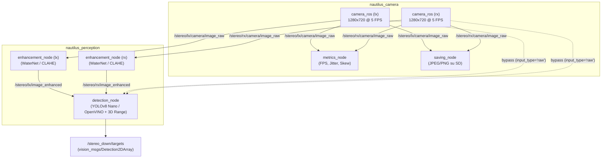

# Nautilus Edge Perception & Vision Benchmark

Pipeline di computer vision edge basata su **ROS 2 (Jazzy)** e accelerata tramite **Intel OpenVINO**, progettata e ottimizzata per l'hardware di bordo (**Raspberry Pi 5**) del modulo fototrappola stereoscopica subacquea nell'ambito del progetto **Nautilus** (Università degli Studi di Padova).

Il progetto è dedicato all'esplorazione autonoma, al monitoraggio dell'ambiente marino e al rilievo di flora e fauna, operando in condizioni critiche di risorse computazionali ristrette, alimentazione a batteria e assenza di dissipazione attiva (camera stagna chiusa, stress termico).

---

## 🧭 Indice della Documentazione e Mappa della Repository

Indice unificato per navigare direttamente in tutta la documentazione, i pacchetti ROS 2 e i moduli presenti nel repository:

### 📄 Documentazione Generale (`docs/`)

* **[Guida al Lancio Globale](docs/global_launch.md)** — Architettura del sistema di lancio dinamico, routing automatico dei topic, gestione delle variabili d'ambiente e comandi di test.
* **[Roadmap Operativa](docs/TODO.md)** — Tabella di marcia suddivisa in 8 fasi (Acquisizione, Enhancement, Salvataggio, Detection, Benchmark, Stress test, Integrazione, Documentazione).
* **[Setup Hardware Pi Camera v3](docs/setup-picam3.md)** — Configurazione del Raspberry Pi 5, overlay CSI nel `config.txt`, comandi `rpicam-hello` e tuning hardware.
* **[Cheat-Sheet Comandi ROS 2](docs/ros2-cmds.md)** — Raccolta di comandi essenziali per build (`colcon`), launch, ispezione nodi/topic e registrazione bag.
* **[Dipendenze Raspberry Pi](docs/requirements_pi.txt)** — Elenco dei pacchetti Python e di sistema per l'ambiente Pi.

### 📦 Workspace e Pacchetti ROS 2 (`ros2_ws/`)

* **[Workspace Overview](ros2_ws/README.md)** — Struttura generale del workspace, istruzioni di build e configurazione CycloneDDS.
* **[Package `nautilus_camera`](ros2_ws/src/nautilus_camera/README.md)** — Acquisizione hardware 720p @ 5 FPS, nodo di benchmark (`metrics_node`), nodo di salvataggio immagini su MicroSD (`saving_node`) con gestione crash e assenza RTC.
* **[Package `nautilus_perception`](ros2_ws/src/nautilus_perception/README.md)** — Modulo core di elaborazione visiva: nodo di enhancement (WaterNet/CLAHE) e nodo di detection IA + stereovisione.
  * **[Sottomodulo Detection](ros2_ws/src/nautilus_perception/nautilus_perception/detection/README.md)** — Dettagli su architettura *Detect-Then-Range*, calibrazione stereo ChArUco e matching epipolare.
  * **[Debug & Status](ros2_ws/src/nautilus_perception/nautilus_perception/detection/DEBUG.md)** — Problemi noti/risolti, lock fotometrico (`lock_cameras.py`), workflow operativo e checklist di stato del modulo.
* **[Package `nautilus_msgs`](ros2_ws/src/nautilus_msgs/README.md)** — Definizioni delle interfacce e dei messaggi custom della suite Nautilus.
* **[Driver `camera_ros`](ros2_ws/src/camera_ros/README.md)** — Driver ROS 2 per `libcamera`, integrato per il controllo diretto dei doppi sensori CSI Pi Camera v3.

### ⚙️ Script di Gestione e Deployment (`deploy/`) & Configurazione

* **[Script Avvio Pipeline](deploy/start_pipeline.sh)** — Entry point di boot invocato da systemd per avviare i nodi in base al file `.env`.
* **[Servizio Systemd](deploy/nautilus-vision.service)** — Unit file per l'avvio automatico su Pi al boot (trigger reed switch).
* **[Configurazione Ambiente](pipeline_config.env)** — Switch booleani per abilitare/disabilitare enhancement, detection e salvataggio senza ricompilare.

### 📊 Benchmark & Validation (`benchmarks/`)

* **[Benchmark Overview](benchmarks/README.md)** — Metodologia dei test prestazionali e termici (Fase 5 e 6), configurazioni di pipeline, metriche raccolte (latenza p50/p95, CPU, RAM, temperatura, mAP) e linee guida di riproducibilità.
* **[Script di Benchmark](benchmarks/scripts/)** — `benchmark_pipeline.py`, `system_monitor.py`, `evaluate_map.py`, `plot_results.py`, `model_benchmark.py`.
* **[Dataset di Test](benchmarks/datasets/)** — Immagini e video stereo di test, dataset grezzi annotati e tool di pulizia (`clean_dataset.py`).
* **[Risultati](benchmarks/results/)** — CSV temporizzati e grafici PNG prodotti durante le sessioni.

### 🏛️ Archivio Storico e Componenti Legacy

* **[Sensing Rigs Daemon](sensing-rigs-daemon/README.md)** — Codice sorgente del vecchio demone di acquisizione in C a basso livello.
  * **[Benchmark MicroSD](sensing-rigs-daemon/microsd_benchmark.md)** — Analisi di throughput su schede MicroSD Kingston Canvas Select Plus.
  * **[Ottimizzazione FPS](sensing-rigs-daemon/fps_optimization_summary.md)** — Studio sui colli di bottiglia e latenze del demone legacy.
  * **[TODO Legacy Daemon](sensing-rigs-daemon/TODO.md)** — Obiettivi di sviluppo del vecchio demone.

---

## 🏗️ Architettura dei 4 Nodi della Pipeline

L'architettura della visione stereoscopica è organizzata in 4 nodi distribuiti su 2 pacchetti principali:



1. **Nodo 1 — Acquisizione (`camera_ros`, package `nautilus_camera`):**
   * Gestisce in contemporanea le due telecamere Pi Camera v3 su bus CSI.
   * Risoluzione forzata a **720p (1280×720)** e framerate calibrato a **5 FPS** (`FrameDurationLimits: [200000, 200000]`).
   * Include il nodo diagnostico [`metrics_node`](ros2_ws/src/nautilus_camera/nautilus_camera/metrics_node.py) per monitorare FPS effettivi, jitter e skew stereo (~1.5 ms).
2. **Nodo 2 — Salvataggio (`saving_node`, package `nautilus_camera`):**
   * Salva le coppie di frame stereo su MicroSD con naming incrementale ordinabile (`nautilus_lx_00000001.jpg`).
   * Supporta isolamento delle sessioni con protezione automatica da sovrascrittura in caso di orologio di sistema non sincronizzato (assenza RTC).
   * Esegue `os.sync()` regolabile tramite parametro `flush_every_n` per evitare la perdita di file in caso di spegnimento immediato da reed switch.
   * Controllabile dinamicamente a runtime tramite servizio ROS 2 `~/set_saving` (`std_srvs/srv/SetBool`).
3. **Nodo 3 — Enhancement (`enhancement_node`, package `nautilus_perception`):**
   * Applica algoritmi di miglioramento del contrasto e bilanciamento cromatico subacqueo su entrambi i flussi stereo.
   * Modalità configurabile: `auto` (rilevamento hardware), `force_off` (Sharpening + CLAHE leggero, ideale per Pi 5), `force_on` (WaterNet completo basato su PyTorch).
   * Mantiene invariati i timestamp originali dell'header per non degradare la sincronizzazione stereo a valle.
4. **Nodo 4 — Detection & Stereovisione (`detection_node`, package `nautilus_perception`):**
   * Architettura **Detect-Then-Range**: esegue l'inferenza IA (YOLOv8n / OpenVINO) sul frame sinistro rettificato e campiona la disparità stereo epipolare per calcolare la distanza tridimensionale $Z$.
   * Supporta input commutabile sia da immagini grezze (`/stereo/{lx,rx}/camera/image_raw`) sia migliorate (`/stereo/{lx,rx}/image_enhanced`).
   * Pubblica i target su `/stereo_down/targets` con coordinate 2D/3D in formato `vision_msgs/Detection2DArray`.

---

## 🚀 Logica di Esecuzione e Lancio

La pipeline adotta una duplice modalità di esecuzione per rispondere a due esigenze operative distinte:

### 1. Avvio Automatico di Produzione (All'accensione del Pi)

* **Trigger Hardware:** Quando il robot viene acceso tramite magnete (interruttore reed switch), il sistema operativo avvia il servizio systemd [`nautilus-vision.service`](deploy/nautilus-vision.service).
* **Comportamento:** Il servizio invoca [`start_pipeline.sh`](deploy/start_pipeline.sh), il quale legge le variabili d'ambiente in [`pipeline_config.env`](pipeline_config.env).
* **Nodi avviati:** Viene lanciato [`stereo_camera.launch.py`](ros2_ws/src/nautilus_camera/launch/stereo_camera.launch.py):
  * **Acquisizione:** Obbligatoria (driver `camera_ros` sempre attivi).
  * **Salvataggio:** Opzionale (governato da `ENABLE_SAVING=true/false`).
  * **Metriche:** Attivabili via `ENABLE_METRICS`.
* **Obiettivo:** Evitare l'esecuzione inutile di modelli di deep learning pesanti all'avvio, preservando batteria, RAM e termica per le missioni di acquisizione scientifica.

### 2. Avvio Completo / Benchmark (Fase 5)

* **Launch file globale:** [`pipeline.launch.py`](ros2_ws/src/nautilus_perception/launch/pipeline.launch.py).
* **Comportamento:** Avvia la catena completa o parziale accettando argomenti condizionali con routing automatico dei topic:

  ```bash
  # 1. Configurazione: Solo acquisizione (baseline hardware)
  ros2 launch nautilus_perception pipeline.launch.py \
      enable_enhancement:=false enable_detection:=false enable_saving:=false enable_metrics:=true

  # 2. Configurazione: Acquisizione + Detection (senza pre-processing)
  ros2 launch nautilus_perception pipeline.launch.py \
      enable_enhancement:=false enable_detection:=true enable_saving:=false enable_metrics:=true

  # 3. Configurazione: Pipeline completa (Acquisizione + Enhancement + Detection)
  ros2 launch nautilus_perception pipeline.launch.py \
      enable_enhancement:=true enable_detection:=true enable_saving:=true enable_metrics:=true
  ```

---

## 📊 Mappa Ufficiale dei Topic ROS 2

| Topic | Tipo Messaggio | Publisher | Subscriber Principale | Note |
| --- | --- | --- | --- | --- |
| `/stereo/lx/camera/image_raw` | `sensor_msgs/Image` | `camera_ros (lx)` | `metrics_node`, `saving_node`, `enhancement_node`, `detection_node` (se raw) | Frame grezzo 720p @ 5 FPS camera sinistra |
| `/stereo/rx/camera/image_raw` | `sensor_msgs/Image` | `camera_ros (rx)` | `metrics_node`, `saving_node`, `enhancement_node`, `detection_node` (se raw) | Frame grezzo 720p @ 5 FPS camera destra |
| `/stereo/lx/image_enhanced` | `sensor_msgs/Image` | `enhancement_node (lx)` | `detection_node` (se enhanced) | Immagine migliorata (CLAHE/WaterNet) sx |
| `/stereo/rx/image_enhanced` | `sensor_msgs/Image` | `enhancement_node (rx)` | `detection_node` (se enhanced) | Immagine migliorata (CLAHE/WaterNet) dx |
| `/stereo_down/targets` | `vision_msgs/Detection2DArray` | `detection_node` | Stack di controllo veicolo / Jetson | Bounding box 2D + stima distanza metrica Z |
| `/saving_node/set_saving` | `std_srvs/SetBool` *(Service)* | `saving_node` | Client esterno / operatore | Abilita/disabilita salvataggio a runtime |

---

## 🛠️ Stack Tecnologico e Requisiti

* **Target Hardware:** Raspberry Pi 5 (8 GB RAM) con doppi sensori Sony IMX708 (Pi Camera Module 3).
* **OS & Middleware:** Ubuntu 24.04 LTS a 64 bit con **ROS 2 Jazzy Jalisco**, Domain DDS configurato con **CycloneDDS** (`rmw_cyclonedds_cpp`).
* **Librerie Vision & AI:**
  * OpenCV 4.x (con binding Python e `cv_bridge`).
  * Intel OpenVINO 2024.x per inferenza accelerata su CPU ARM.
  * Ultralytics YOLOv8 (PyTorch).
  * `libcamera` e `camera_ros`.

---

## 💻 Compilazione e Setup del Workspace

```bash
# 1. Spostati nel workspace ROS 2
cd ~/nautilus-vision-pipeline/ros2_ws

# 2. Compila con supporto ai symlink (utile durante lo sviluppo)
colcon build --symlink-install

# 3. Source dell'ambiente
source install/setup.bash
```

---

## 📈 Roadmap di Sviluppo (Allineamento con `TODO.md`)

| Fase | Descrizione | Stato | Componenti Coinvolti |
| --- | --- | --- | --- |
| **Fase 1** | Acquisizione ROS 2 (720p @ 5 FPS, metrics) | ✅ Completata | `camera_ros`, `nautilus_camera/metrics_node`, `nautilus_camera.yaml` |
| **Fase 2** | Nodo di Enhancement (WaterNet / CLAHE) | ✅ Completata | `nautilus_perception/enhancement_node` |
| **Fase 3** | Nodo di Salvataggio su MicroSD (Anti-RTC, Service) | ✅ Completata | `nautilus_camera/saving_node` |
| **Fase 4** | Nodo di Detection (YOLO/OpenVINO + Stereovisione) | ✅ Completata | `nautilus_perception/detection_node`, `detection_params.yaml` |
| **Fase 5** | Benchmarking Comparativo (Latenza p50/p95, CPU, FPS) | 🔄 Prossima | Cartella `benchmarks/`, `pipeline.launch.py` |
| **Fase 6** | Stress Test Termico (1h a box chiusa, thermal throttling) | ⏳ Pianificata | Script di monitoraggio `vcgencmd`, box stagna |
| **Fase 7** | Integrazione con Stack Nautilus & Jetson (Chrony) | ⏳ Pianificata | CycloneDDS, sincronizzazione `chrony` |
| **Fase 8** | Tesi, Slide e Documentazione Finale | 🔄 In corso | Cartella `docs/`, report e grafici |

---

## 📁 Struttura della Cartella `benchmarks/` per la Fase 5

Per i test prestazionali e termici della **Fase 5**, è consigliato organizzare i file all'interno della cartella dedicata `benchmarks/` nella radice del progetto:

```text
benchmarks/
├── scripts/
│   ├── benchmark_pipeline.py    # Profilazione latenze p50/p95 e delay inter-nodo
│   ├── system_monitor.py        # Logging CPU%, RAM, temperatura, vcgencmd throttled
│   ├── evaluate_map.py          # Calcolo mAP sul validation set per ogni variante
│   ├── plot_results.py          # Grafici comparativi a partire dai CSV
│   ├── model_benchmark.py       # Confronto .pt vs OpenVINO standalone (no ROS)
│   ├── check_imgsz.py           # Ispeziona shape input di .pt e .ov
│   └── run_benchmark.sh         # Wrapper: lancia un run completo di una config
├── datasets/
│   ├── images/                  # Immagini di test (enhancement, waternet)
│   ├── videos/                  # Video stereo di test
│   ├── raw/                     # Dataset grezzi annotati
│   ├── processed/               # Output di clean_dataset.py
│   └── tools/
│       └── clean_dataset.py     # Filtro varianza Laplaciano per selezione frame
├── results/
│   ├── csv/                     # Dati grezzi temporizzati
│   └── plots/                   # Immagini PNG dei grafici
└── README.md                    # Metodologia di test e riproducibilità
```

---

## 🤝 Riconoscimenti e Codice di Terze Parti

* **Sensing Rigs Daemon (`sensing-rigs-daemon/`):** Codice sviluppato per la phototrap Nautilus; rimane versionato come riferimento storico e per il confronto delle metriche di acquisizione.
* **Algoritmo di Image Enhancement (`ros2_ws/src/nautilus_perception/nautilus_perception/enhancement/`):** Il codice sorgente core dell'algoritmo di miglioramento delle immagini deriva dal repository [underwater-image-enhancement](https://github.com/nautilus-unipd/underwater-image-enhancement) del team Nautilus ed è stato incapsulato ("wrappato") all'interno di un nodo ROS 2 compatibile con la pipeline.
* **Marine Debris Computer Vision (`ros2_ws/src/nautilus_perception/nautilus_perception/detection/`):** I pesi e la metodologia per l'identificazione di detriti marini provengono dal lavoro svolto nel repository [marine_debris_CV](https://github.com/bazzy22/marine_debris_CV) di Manuel, adattati ed esportati in formato OpenVINO per inferenza edge su Raspberry Pi.
* **Acquisizione Hardware (`camera_ros`):** Il driver ROS 2 per `libcamera` è basato sul progetto open source [camera_ros](https://github.com/christianrauch/camera_ros) di Christian Rauch.
