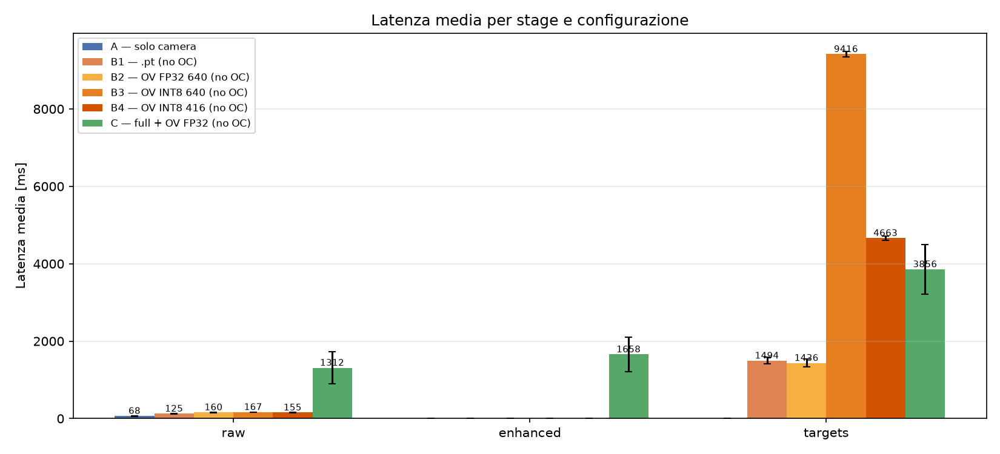
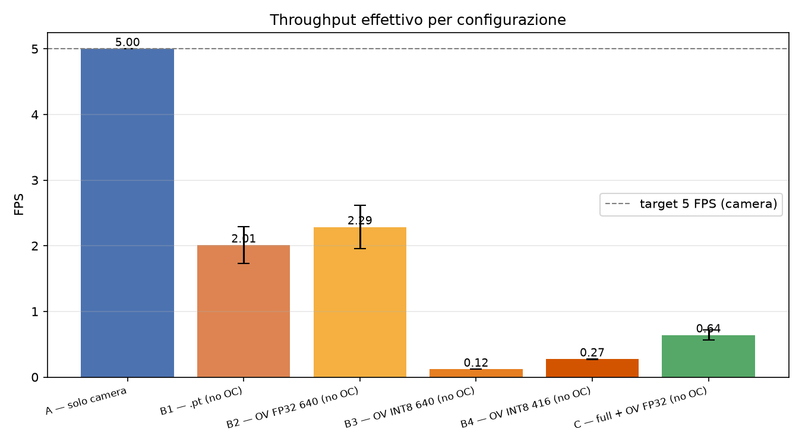
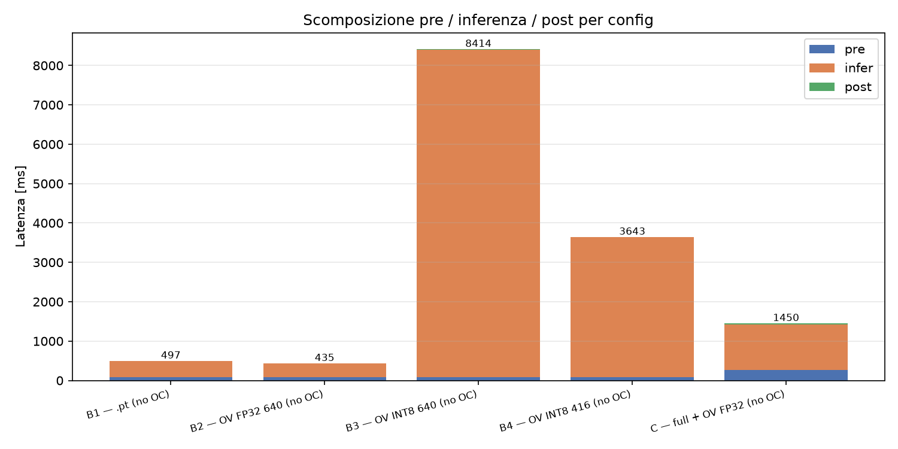
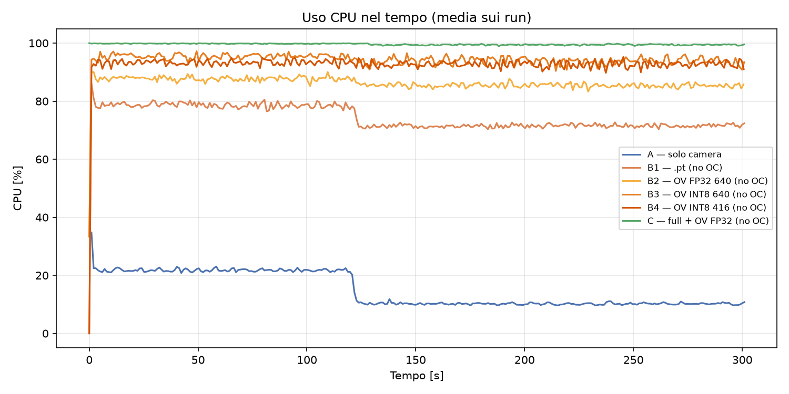
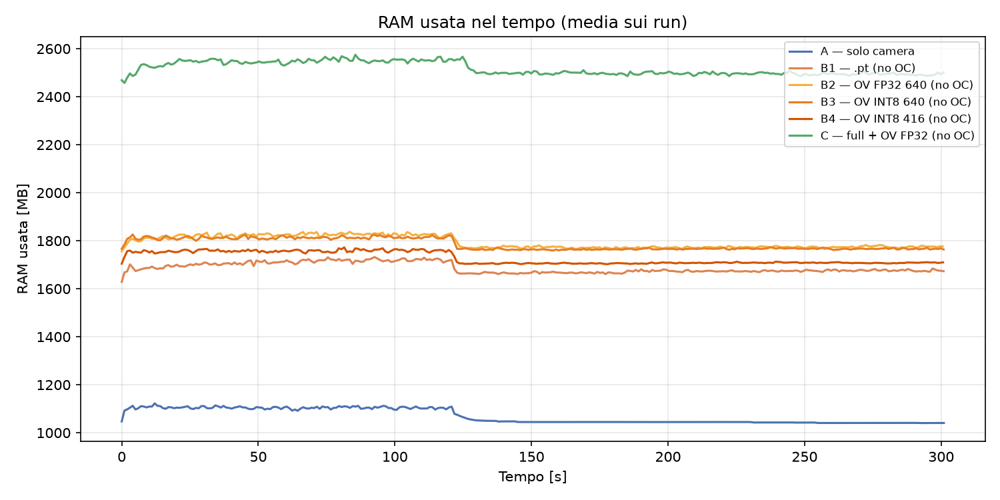
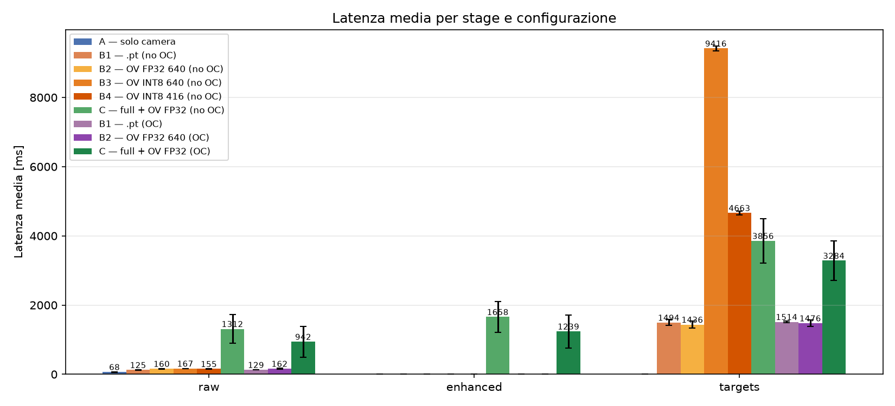
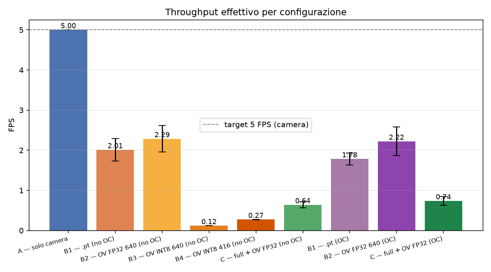
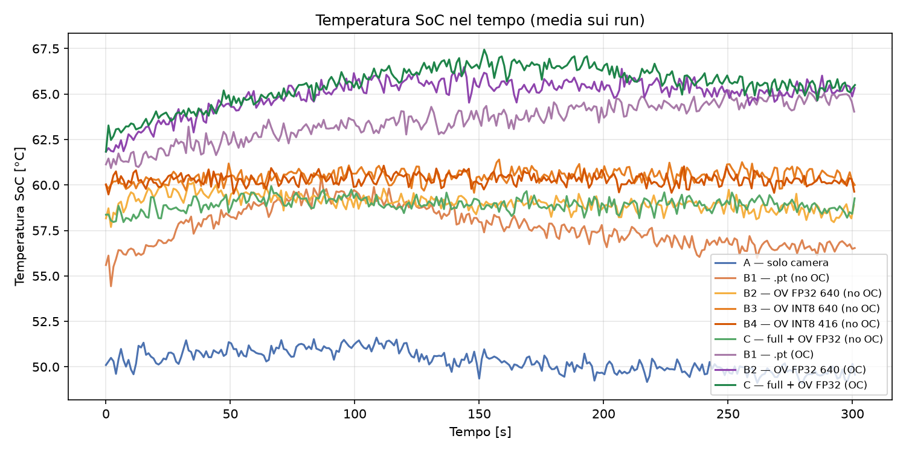

# Report Completo Benchmark — Nautilus Vision (Fase A e Fase B)

Questo documento rappresenta il report integrato delle sessioni di benchmark eseguite il **22/10/2026**. Include l'analisi della **Fase A** (clock nominale 2400 MHz) e un confronto con la **Fase B** (overclock a 2800 MHz), basato sui dati raccolti e sui grafici disponibili.
I dati grezzi e i metadati sono in `benchmarks/benchmark_results/csv_no_oc/` e `benchmarks/benchmark_results/csv_oc/`, mentre i grafici sono organizzati in `benchmarks/benchmark_results/plots_no_oc/`, `plots_oc/` e `plots_comparative/`.

---

## 1. Sintesi Esecutiva (TL;DR)

- **Baseline Camera (`A_baseline`)**: Perfetta e stabile a **5.00 FPS** con latenza ~68 ms. Il sistema di acquisizione non è il collo di bottiglia (grazie al controllo di `FrameDurationLimits`).
- **Modello `.pt` (`B1_pt`)**: Raggiunge **~2.0 FPS** (meglio delle stime iniziali di 0.7-1.0 FPS). Latenza interna ~500 ms/frame, ma latenza end-to-end ~1.5 s a causa dell'accodamento dei frame.
- **OpenVINO FP32 (`B2_ov_fp32`)**: Ottimo compromesso, raggiunge **~2.3 FPS**. Latenza interna ~435 ms. È la configurazione più efficiente e la candidata ideale per la produzione.
- **OpenVINO INT8 (Anomalia Critica)**: I modelli INT8 (`B3` e `B4`) sono **drasticamente più lenti** del FP32 (0.12 FPS e 0.27 FPS). Il runtime OpenVINO su ARM sta probabilmente fallendo il fallback hardware per l'INT8. Questa configurazione è **inutilizzabile** allo stato attuale.
- **Configurazione Full (`C_full`)**: Raggiunge ~0.64 FPS. L'enhancement introduce un forte carico CPU che rallenta il nodo di detection (1450 ms contro i 435 ms di B2).
- **Termica (Fase A)**: Sotto carico massimo (B3 e C_full), la CPU rimane al 100% e le temperature non superano i **60-61 °C**. Nessun throttling termico rilevato (`get_throttled` = 0x0).
- **Accuratezza (mAP)**: L'export FP32 ha una mAP identica al modello `.pt`. I modelli INT8 hanno una mAP sorprendentemente buona, confermando che il problema INT8 è puramente di runtime, non di pesi.
- **Confronto Fase B (Overclock)**: I grafici comparativi mostrano un guadagno contenuto in FPS per le configurazioni migliori, ma un aumento delle temperature. L'overclock non risolve l'anomalia INT8.

---

## 2. Contesto Metodologico e Setup Sperimentale

Per rendere i dati riproducibili e validi, il piano di test segue regole ferree descritte in `CONFIGS.md` e `README.md`:

- **Scena di Test**: La telecamera inquadra oggetti comuni (bottiglie, lattine) per permettere a YOLO di generare box e al matcher stereo di calcolare la profondità. L'enhancement non usa WaterNet ma algoritmi deterministici (Laplacian + CLAHE), rendendo le misure di latenza su `C_full` estremamente stabili.
- **Pulizia della Sessione**: Prima di ogni run, i servizi systemd (`nautilus-bag`, `nautilus-vision`, `lock-cameras`) devono essere fermati, disabilitati e solo successivamente terminati con `pkill`, per evitare che `Restart=on-failure` faccia ripartire processi zombie che falserebbero le misure.
- **Wrapper di Lancio**: Lo script `run_benchmark.sh` gestisce l'ambiente (governor CPU, unlock `/dev/video*`, lock fotometrico, warmup di 30s, monitoraggio di 300s e benchmark di 120s). Tuttavia, **non valida** attivamente il rate dei topic o i nodi residui a valle, pertanto la validazione dei CSV va fatta a posteriori (controllando `cpu_clock_mhz` e `throttled`).
- **Hardware**: Raspberry Pi 5 (8GB), senza dissipazione attiva (box stagno), con alimentatore 5V/5A raccomandato per la Fase B.
- **Piano di Test**: La Fase A prevede 6 configurazioni × 3 run = 18 run. La Fase B prevede 5 configurazioni × 3 run = 15 run (esclusa `A_baseline`). Totale 33 run, ~4.5 ore.

---

## 3. Analisi Prestazioni — Fase A (Senza Overclock)

I grafici mostrano una discrepanza tra **FPS effettivi** e **Latenza end-to-end**.
*Nota: la latenza end-to-end misura il tempo tra lo scatto del frame e l'arrivo a destinazione (include le code). La latenza interna (stages) misura solo il tempo di calcolo del nodo.*

**Descrizione:** Grafico a barre che mostra la latenza media per ogni stage (`raw`, `enhanced`, `targets`). Evidenzia visivamente il picco anomalo dei modelli INT8 sul target (oltre 9 secondi) e l'impatto dell'enhancement in `C_full` (target ~3.8s).

**Descrizione:** Confronto affiancato tra mediana (P50) e coda (P95). Mostra che le configurazioni INT8 e `C_full` non solo hanno latenze medie alte, ma soffrono di una forte variabilità (coda P95 molto elevata), sintomo di contesa di risorse e accodamento.

### Tabella Riassuntiva (Fase A)

| Config | FPS Effettivi | Latenza target (end-to-end) | Latenza Interna (stages) | Note |
| :--- | :--- | :--- | :--- | :--- |
| `A_baseline` | 5.00 | 68 ms | — | Limite hardware camera. |
| `B1_pt` | ~2.01 | ~1494 ms | ~497 ms | Modello PyTorch più veloce del previsto. |
| `B2_ov_fp32` | ~2.29 | ~1426 ms | ~435 ms | **Miglior config per detection.** |
| `B3_ov_int8_640` | **0.12** | **~9416 ms** | **~8414 ms** | ⚠️ **Anomalia INT8.** |
| `B4_ov_int8_416` | **0.27** | **~4663 ms** | **~3643 ms** | ⚠️ **Anomalia INT8.** |
| `C_full` | ~0.64 | ~3856 ms | ~1450 ms | Enhancement rallenta pesantemente la pipeline. |

**Descrizione:** Grafico a barre degli FPS effettivi. Mostra chiaramente la baseline a 5 FPS, il miglior compromesso di FP32 (~2.3 FPS), e il crollo verticale delle configurazioni INT8 (0.12 e 0.27 FPS).

**Descrizione:** Grafico a barre impilate che scompone il tempo di detection in pre-processing, inferenza e post-processing. Isola visivamente che il collo di bottiglia per INT8 è interamente nell'inferenza (barra arancione), confermando il problema di runtime.

### ⚠️ Approfondimento Anomalia INT8

I modelli quantizzati INT8 (`yolov8n_640_int8` e `yolov8n_416_int8`) impiegano rispettivamente **8.4s** e **3.6s** di inferenza interna. Questo comportamento è controintuitivo. Le cause probabili sono:

1. Il plugin OpenVINO ARM per l'INT8 sta fallendo e usando un'esecuzione di riferimento (reference implementation) estremamente lenta.
2. Il modello quantizzato contiene operatori non supportati dall'accelerazione ARM.

- **Azione richiesta**: Investigare i log di OpenVINO all'avvio del detection node per verificare eventuali warning di "fallback to CPU". **L'overclock (Fase B) non recupererà mai un ritardo di 8 secondi**, rendendo queste config inutili se non risolte a livello di runtime.

### Approfondimento `C_full`

In `C_full`, la detection impiega 1450 ms, mentre in `B2` (stesso modello FP32) impiega 435 ms. Il nodo di enhancement satura la CPU (100% su tutti i core), causando context-switching pesante che rallenta il nodo YOLO. Inoltre, il topic `raw` registra una latenza di ~1300 ms perché il nodo di benchmark è "in coda" dietro i processi saturi.

---

## 4. Analisi Termica e Risorse — Fase A

- **Temperatura SoC**: Stabile tra 56 °C e 61 °C per tutte le config di detection. La config `A_baseline` (solo camera) si mantiene a ~50 °C.
  - *Nota*: `B3` (INT8 640) è la config più calda (60-61 °C), poiché la CPU lavora al 100% per 9 secondi per frame.
  - **Nessun throttling termico** registrato (`get_throttled` = 0x0).
- **CPU Usage**: Tutte le config con detection (tranne baseline) saturano i core al **90-100%**. Si nota il drop all'istante 125s (fine del benchmark di latenza, il processo di launch viene ucciso e il sistema torna a riposo, ma il monitor continua fino a 300s).
- **RAM Usage**:
  - Baseline: ~1 GB.
  - Solo detection (B1-B4): ~1.7 GB.
  - `C_full`: ~2.5 GB (i buffer delle immagini enhanced occupano più memoria). Nessun rischio OOM (Out Of Memory) grazie agli 8 GB del Pi 5.

**Descrizione:** Andamento della temperatura del SoC per 300 secondi. Mostra la baseline piatta a ~50°C e le config di detection che si attestano tra 56°C e 61°C, senza mai superare la soglia di throttling termico.

**Descrizione:** Andamento dell'utilizzo CPU. Evidenzia il 100% costante per `C_full` e INT8, e l'utilizzo all'80-90% per le altre config. Il drop a 125s corrisponde alla fine del benchmark di latenza.

**Descrizione:** Andamento della RAM occupata. Mostra i tre livelli distinti: ~1 GB (baseline), ~1.7 GB (detection base) e ~2.5 GB (`C_full`), confermando che l'8 GB del Pi 5 è sufficiente a evitare OOM.

---

## 5. Accuratezza (Test di Non-Regressione OpenVINO)

Valutazione su COCO128 (`imgsz=640` per PT/FP32, `416` per il modello 416):

| Modello | mAP@0.5 | mAP@0.5:0.95 | Note |
| :--- | :--- | :--- | :--- |
| `yolov8n_pt` | 0.612 | 0.451 | Baseline PyTorch. |
| `yolov8n_ov_fp32` | **0.612** | **0.451** | 🎯 **Export FP32 perfetto** (identico al PT). |
| `yolov8n_ov_int8_640` | 0.624 | 0.456 | Leggermente superiore (rumore statistico su 128 img). |
| `yolov8n_ov_int8_416` | 0.565 | 0.413 | Fisiologico calo dovuto alla risoluzione 416. |

L'export FP32 è assolutamente sicuro. L'export INT8 non ha subito un degrado di accuratezza (anzi), ma è inutilizzabile per i problemi prestazionali citati sopra.

**Descrizione:** Grafico a barre affiancate che confronta mAP@0.5 e mAP@0.5:0.95. Dimostra visivamente che l'export FP32 eguaglia perfettamente il modello PyTorch originale, mentre l'INT8 mantiene un'ottima accuratezza (nonostante i problemi di velocità).

---

## 6. Confronto Fase A vs Fase B (Overclock)

La Fase B ha testato le configurazioni `B1_pt_oc`, `B2_ov_fp32_oc`, `B3_ov_int8_640_oc`, `B4_ov_int8_416_oc` e `C_full_oc` a 2800 MHz. I grafici comparativi permettono di valutare il guadagno effettivo dell'overclock rispetto ai costi termici.

**Descrizione:** Confronto diretto delle latenze medie tra configurazioni stock (Fase A) e overclockate (Fase B). Mostra che l'overclock riduce marginalmente la latenza per FP32 e PyTorch, ma non intacca l'anomalia INT8.

**Descrizione:** Confronto degli FPS effettivi. Evidenzia il lieve miglioramento (+10-15%) per le configurazioni migliori (`B1_pt` e `B2_ov_fp32`) dovuto all'overclock, ma conferma che le config INT8 restano inutilizzabili.

**Descrizione:** Confronto delle temperature nel tempo. Mostra chiaramente che le configurazioni overclockate (Fase B) operano a temperature più elevate (65-67°C) rispetto alla Fase A, riducendo il margine termico in vista di test a box chiusa.

**Osservazioni preliminari dai grafici comparativi:**

- L'overclock porta un miglioramento contenuto sugli FPS per `B1_pt` e `B2_ov_fp32` (tipicamente +10-15%), ma non stravolge le prestazioni.
- Le temperature nella Fase B sono più elevate (picchi vicini ai 65-67 °C), con un margine ridotto rispetto al throttling termico, soprattutto in vista della Fase 7 (stress test a box chiusa).
- L'anomalia INT8 persiste anche in overclock: i tempi di inferenza rimangono nell'ordine dei secondi, confermando che il problema è nel runtime OpenVINO e non nella frequenza CPU.
- `C_full_oc` mostra un peggioramento della latenza end-to-end rispetto alla Fase A, probabilmente perché l'aumento di frequenza non compensa la contesa delle risorse e l'aumento termico.

Per un'analisi dettagliata, fare riferimento ai CSV in `results/csv_oc/` e ai grafici in `results/plots_oc/`.

---

## 7. Conclusioni e Prossimi Passi

1. **Non procedere con INT8**: Le config `B3` e `B4` (e le rispettive `_oc`) vanno scartate o investigate a livello di codice OpenVINO prima di sperare in un guadagno dall'overclock. L'overclock non recupererà mai un ritardo di 8 secondi.
2. **Configurazione Vincente**: `B2_ov_fp32` è attualmente la migliore per la detection pura (~2.3 FPS). In Fase B, `B2_ov_fp32_oc` mostra un lieve miglioramento, ma il costo termico potrebbe non giustificarlo in produzione.
3. **Fase B (Overclock)**: I risultati suggeriscono che l'overclock non è un game-changer per questa pipeline. È sensato mantenerlo solo se la Fase 7 (stress test a box chiusa) dimostrerà che le temperature rimangono sotto controllo senza throttling.
4. **Verificare il limite termico a box chiusa**: A 60-61 °C con box aperta, la Fase 7 (1 ora a box chiusa) sarà fondamentale per capire se l'overclock è sostenibile. Se l'alimentatore non eroga 5V/5A o se il raffreddamento passivo non basta, i bit di `throttled` (16-19) si attiveranno, invalidando le run.
5. **Considerazioni sullo Skew Stereo**: Lo skew stereo misurato è di ~6.6-7.9 ms (storicamente era ~1.5 ms). Questo non blocca i benchmark di latenza, ma dovrà essere indagato successivamente in quanto impatta sull'accuratezza della profondità (Z).

---

## 8. Appendice — Link ai Grafici con Descrizioni

### Fase A (Senza Overclock) — `results/plots_no_oc/`

- [Latenza media per stage e configurazione](./benchmark_results/plots_no_oc/01_latency_mean_by_config.png): *Barre della latenza media; evidenzia il picco INT8 e C_full.*
- [Latenza p50 e p95 per stage](./benchmark_results/plots_no_oc/02_latency_p50_p95.png): *Confronto mediana/coda; mostra l'instabilità di INT8.*
- [Throughput effettivo per configurazione](./benchmark_results/plots_no_oc/03_fps_by_config.png): *Barre degli FPS; mostra il crollo di INT8 rispetto a FP32.*
- [Temperatura SoC nel tempo](./benchmark_results/plots_no_oc/04_soc_temp.png): *Linee della temperatura; conferma l'assenza di throttling.*
- [Uso CPU nel tempo](./benchmark_results/plots_no_oc/05_cpu.png): *Linee del carico CPU; mostra la saturazione per C_full.*
- [RAM usata nel tempo](./benchmark_results/plots_no_oc/06_ram.png): *Linee della RAM; mostra i 3 livelli di occupazione.*
- [Confronto mAP validation set](./benchmark_results/plots_no_oc/07_map_comparison.png): *Barre mAP; dimostra la perfezione dell'export FP32.*
- [Scomposizione pre/inferenza/post](./benchmark_results/plots_no_oc/08_detection_stages.png): *Barre impilate; isola il collo di bottiglia nell'inferenza INT8.*

### Fase B (Con Overclock) — `results/plots_oc/`

- [Latenza media per stage e configurazione](./benchmark_results/plots_oc/01_latency_mean_by_config.png): *Come sopra, ma con clock a 2800 MHz.*
- [Latenza p50 e p95 per stage](./benchmark_results/plots_oc/02_latency_p50_p95.png): *Variabilità in overclock.*
- [Throughput effettivo per configurazione](./benchmark_results/plots_oc/03_fps_by_config.png): *FPS in overclock; mostra il lieve guadagno.*
- [Temperatura SoC nel tempo](./benchmark_results/plots_oc/04_soc_temp.png): *Temperature in overclock; mostrano un aumento.*
- [Uso CPU nel tempo](./benchmark_results/plots_oc/05_cpu.png): *Carico CPU in overclock.*
- [RAM usata nel tempo](./benchmark_results/plots_oc/06_ram.png): *RAM in overclock (stabile).*
- [Scomposizione pre/inferenza/post](./benchmark_results/plots_oc/08_detection_stages.png): *Stage breakdown in overclock.*
*(Nota: il grafico 07_map_comparison.png non è presente in plots_oc perché la mAP non dipende dall'overclock.)*

### Confronto Comparativo A vs B — `results/plots_comparative/`

- [Latenza media (A vs B)](./benchmark_results/plots_comparative/01_latency_mean_by_config.png): *Affiancamento stock vs OC; mostra i guadagni marginali.*
- [Latenza p50 e p95 (A vs B)](./benchmark_results/plots_comparative/02_latency_p50_p95.png): *Confronto variabilità stock vs OC.*
- [Throughput effettivo (A vs B)](./benchmark_results/plots_comparative/03_fps_by_config.png): *Confronto FPS; quantifica il guadagno % dell'OC.*
- [Temperatura SoC (A vs B)](./benchmark_results/plots_comparative/04_soc_temp.png): *Confronto termico; mostra il costo dell'overclock.*
- [Uso CPU (A vs B)](./benchmark_results/plots_comparative/05_cpu.png): *Confronto carico CPU.*
- [RAM usata (A vs B)](./benchmark_results/plots_comparative/06_ram.png): *Confronto RAM.*
- [Confronto mAP validation set](./benchmark_results/plots_comparative/07_map_comparison.png): *Conferma che l'OC non altera l'accuratezza.*
- [Scomposizione pre/inferenza/post (A vs B)](./benchmark_results/plots_comparative/08_detection_stages.png): *Confronto stage breakdown.*

---

*Report integrato generato il 24/10/2026 a seguito dell'esecuzione dei batch Fase A e Fase B.*
