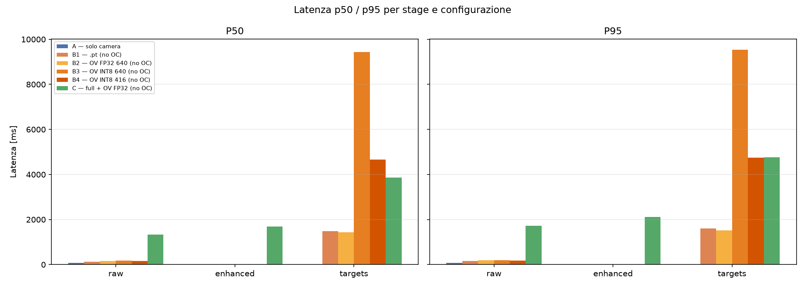
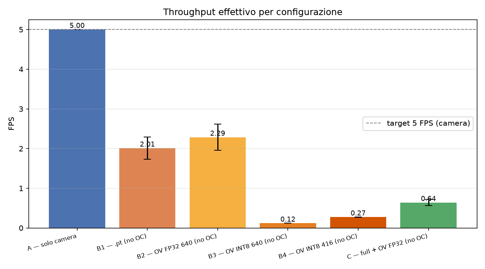
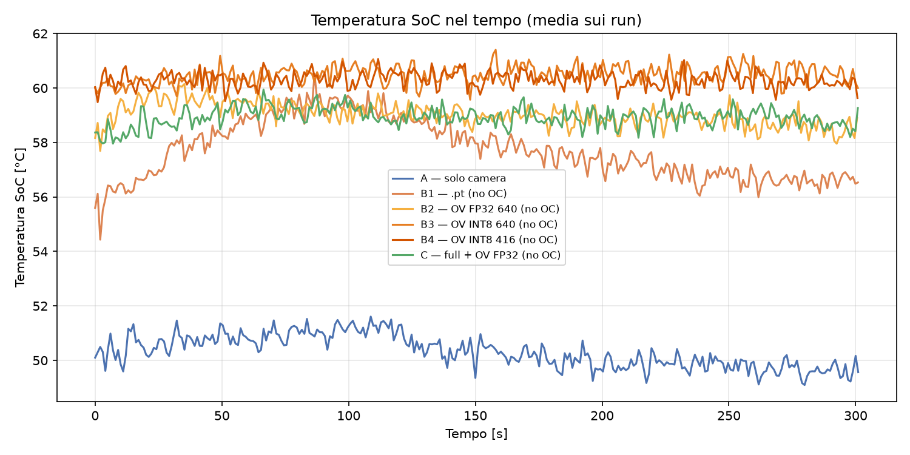
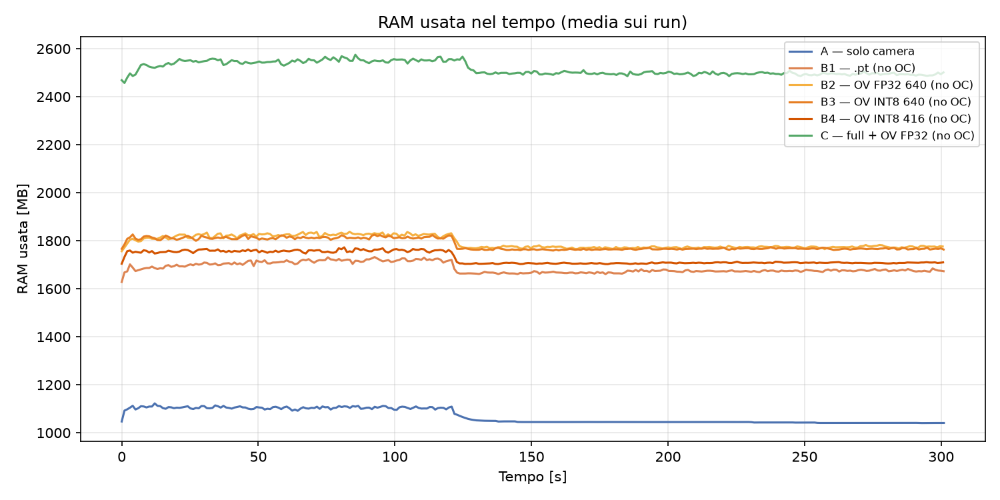
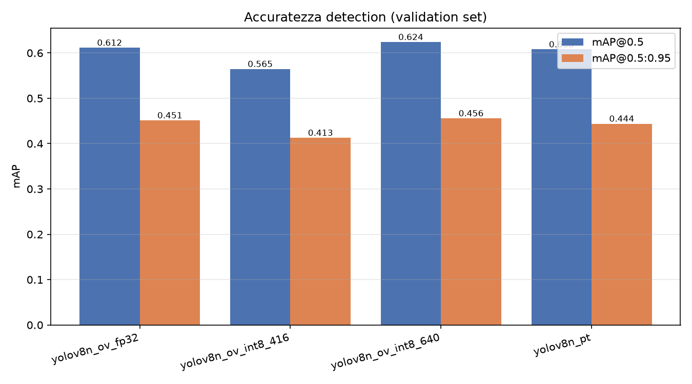

# Risultati Benchmark — Fase 6 (Senza Overclock)

Questo documento riassume i risultati della **Fase A** (clock nominale 2400 MHz) eseguita il **22/10/2026**.
I dati grezzi e i metadati sono in `benchmarks/results/csv/`, mentre i grafici qui inclusi sono in `benchmarks/results/plots/`.

---

## 1. Sintesi Esecutiva (TL;DR)

- **Baseline Camera**: Perfetta e stabile a **5.00 FPS** con latenza ~68 ms. Il sistema di acquisizione non è il collo di bottiglia.
- **Modello `.pt` (PyTorch)**: Raggiunge **~2.0 FPS** (meglio delle stime iniziali di 0.7-1.0 FPS). Latenza interna ~500 ms/frame, ma latenza end-to-end ~1.5 s a causa dell'accodamento dei frame.
- **OpenVINO FP32**: Ottimo compromesso, raggiunge **~2.3 FPS**. Latenza interna ~435 ms. È la configurazione più efficiente.
- **OpenVINO INT8 (Anomalia Critica)**: I modelli INT8 (B3 e B4) sono **drasticamente più lenti** del FP32 (0.12 FPS e 0.27 FPS). Il runtime OpenVINO su ARM sta probabilmente fallendo il fallback hardware per l'INT8. Questa configurazione è **inutilizzabile** allo stato attuale.
- **Configurazione Full `C_full`**: Raggiunge ~0.64 FPS. L'enhancement introduce un forte carico CPU che rallenta il nodo di detection (1450 ms contro i 435 ms di B2).
- **Termica**: Sotto carico massimo (B3 e C_full), la CPU rimane al 100% e le temperature non superano i **60-61 °C**. Nessun throttling termico rilevato.
- **Accuratezza (mAP)**: L'export FP32 ha una mAP identica al modello `.pt`. I modelli INT8 hanno una mAP sorprendentemente buona, confermando che il problema INT8 è puramente di runtime, non di pesi.

---

## 2. Analisi Prestazioni (Latenza e FPS)

I grafici mostrano una discrepanza tra **FPS effettivi** e **Latenza end-to-end**.
*Nota: la latenza end-to-end misura il tempo tra lo scatto del frame e l'arrivo a destinazione (include le code). La latenza interna (stages) misura solo il tempo di calcolo del nodo.*

### Tabella Riassuntiva

| Config | FPS Effettivi | Latenza target (end-to-end) | Latenza Interna (stages) | Note |
| :--- | :--- | :--- | :--- | :--- |
| `A_baseline` | 5.00 | 68 ms | — | Limite hardware camera. |
| `B1_pt` | ~2.01 | ~1494 ms | ~497 ms | Il modello PyTorch è più veloce del previsto. |
| `B2_ov_fp32` | ~2.29 | ~1426 ms | ~435 ms | **Miglior config per detection.** |
| `B3_ov_int8_640` | **0.12** | **~9416 ms** | **~8414 ms** | ⚠️ **Anomalia INT8.** |
| `B4_ov_int8_416` | **0.27** | **~4663 ms** | **~3643 ms** | ⚠️ **Anomalia INT8.** |
| `C_full` | ~0.64 | ~3856 ms | ~1450 ms | Enhancement rallenta pesantemente la pipeline. |

### Throughput Effettivo

### Scomposizione Stage (Pre / Inferenza / Post)

### ⚠️ Approfondimento Anomalia INT8

I modelli quantizzati INT8 (`yolov8n_640_int8` e `yolov8n_416_int8`) impiegano rispettivamente **8.4s** e **3.6s** di inferenza interna. Questo comportamento è controintuitivo. Le cause probabili sono:

1. Il plugin OpenVINO ARM per l'INT8 sta fallendo e usando un'esecuzione di riferimento (reference implementation) estremamente lenta.
2. Il modello quantizzato contiene operatori non supportati dall'accelerazione ARM.
*Azione richiesta: Investigare i log di OpenVINO all'avvio del detection node per verificare eventuali warning di "fallback to CPU".*

### Approfondimento `C_full`

In `C_full`, la detection impiega 1450 ms, mentre in `B2` (stesso modello FP32) impiega 435 ms. Il nodo di enhancement satura la CPU (100% su tutti i core), causando context-switching pesante che rallenta il nodo YOLO. Inoltre, il topic `raw` registra una latenza di ~1300 ms perché il nodo di benchmark è "in coda" dietro i processi saturi.

---

## 3. Analisi Termica e Risorse

- **Temperatura SoC**: Stabile tra 56 °C e 61 °C per tutte le config di detection. La config `A_baseline` (solo camera) si mantiene a ~50 °C.
  - *Nota*: `B3` (INT8 640) è la config più calda (60-61 °C), poiché la CPU lavora al 100% per 9 secondi per frame.
  - **Nessun throttling termico** registrato (`get_throttled` = 0x0).
- **CPU Usage**: Tutte le config con detection (tranne baseline) saturano i core al **90-100%**. Si nota il drop all'istante 125s (fine del benchmark di latenza, il processo di launch viene ucciso e il sistema torna a riposo, ma il monitor continua fino a 300s).
- **RAM Usage**:
  - Baseline: ~1 GB.
  - Solo detection (B1-B4): ~1.7 GB.
  - `C_full`: ~2.5 GB (i buffer delle immagini enhanced occupano più memoria). Nessun rischio OOM (Out Of Memory) grazie agli 8 GB del Pi 5.

### Grafici di Sistema

---

## 4. Accuratezza (Test di Non-Regressione OpenVINO)

Valutazione su COCO128 (`imgsz=640` per PT/FP32, `416` per il modello 416):

| Modello | mAP@0.5 | mAP@0.5:0.95 | Note |
| :--- | :--- | :--- | :--- |
| `yolov8n_pt` | 0.612 | 0.451 | Baseline PyTorch. |
| `yolov8n_ov_fp32` | **0.612** | **0.451** | 🎯 **Export FP32 perfetto** (identico al PT). |
| `yolov8n_ov_int8_640` | 0.624 | 0.456 | Leggermente superiore (rumore statistico su 128 img). |
| `yolov8n_ov_int8_416` | 0.565 | 0.413 | Fisiologico calo dovuto alla risoluzione 416. |

L'export FP32 è assolutamente sicuro. L'export INT8 non ha subito un degrado di accuratezza (anzi), ma è inutilizzabile per i problemi prestazionali citati sopra.

---

## 5. Conclusioni e Prossimi Passi (Fase B)

1. **Non procedere con INT8**: Le config `B3` e `B4` (e le rispettive `_oc` in Fase B) vanno scartate o investigate a livello di codice OpenVINO prima di sperare in un guadagno dall'overclock. L'overclock non recupererà mai un ritardo di 8 secondi.
2. **Configurazione Vincente**: `B2_ov_fp32` è attualmente la migliore per la detection pura (~2.3 FPS).
3. **Fase B (Overclock)**: È sensato testare l'overclock solo su `B1_pt`, `B2_ov_fp32` e `C_full`. Se i 2800 MHz porteranno un +10-20% di FPS, `B2_ov_fp32` potrebbe raggiungere i ~2.7 FPS, che è il limite massimo per non far accumulare troppa coda (e mantenere la latenza sotto 1s).
4. **Verificare il limite termico a box chiusa**: A 60 °C con box aperta, la Fase 7 (1 ora a box chiusa) sarà fondamentale per capire se l'overclock è sostenibile.

---
*Report generato il 22/10/2026 a seguito dell'esecuzione del batch Fase A.*
