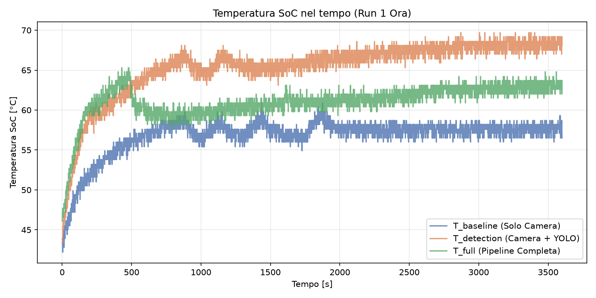
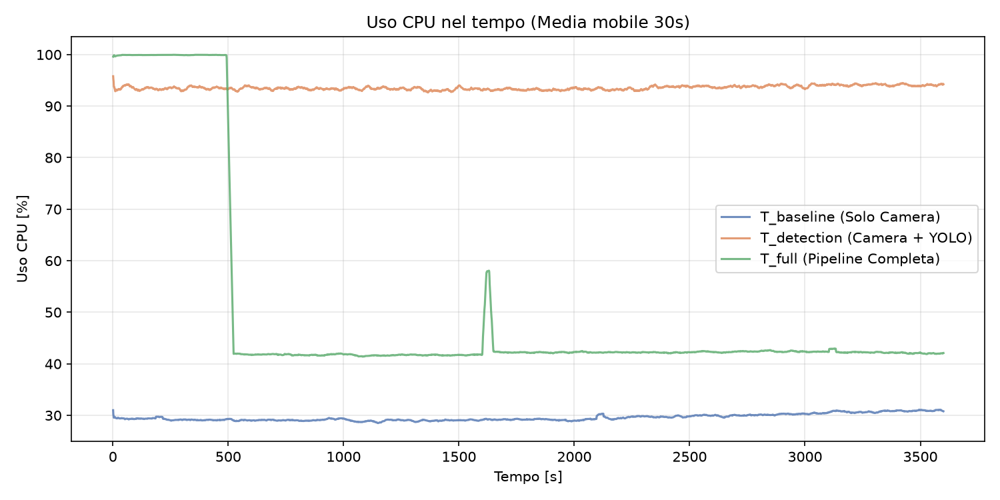
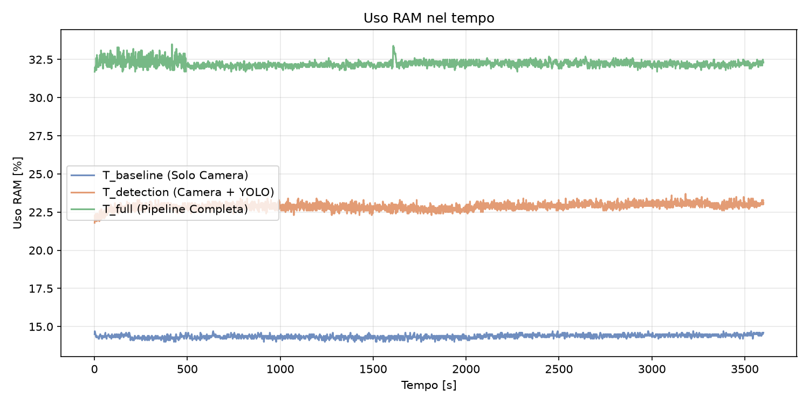
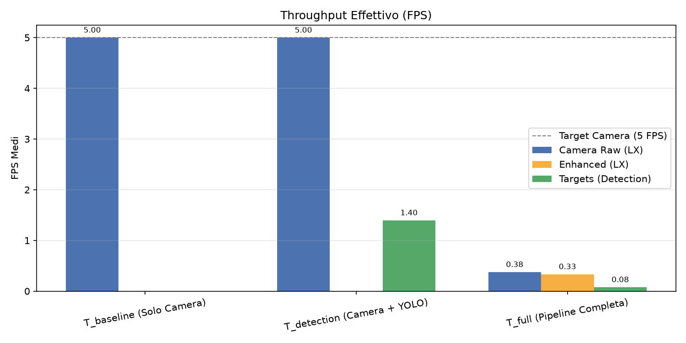
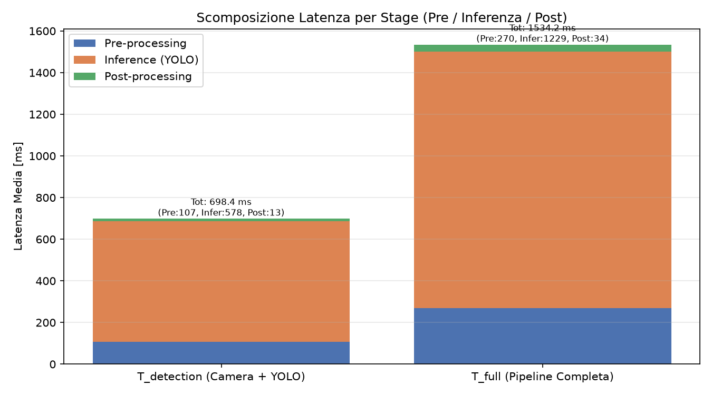

# Report Completo Benchmark Termico (1 Ora) — Nautilus Vision

Questo documento rappresenta il report integrato della sessione di benchmark termico ad alta durata (run da 60 minuti per configurazione) eseguita il **26/10/2026**. L'obiettivo è valutare la stabilità termica, la saturazione delle risorse (CPU/RAM) e il throughput prestazionale di **Nautilus Vision** su Raspberry Pi 5 in ambiente sigillato a dissipazione passiva.

I dati grezzi sono conservati nei file di log `2026-10-26_T_*_thermal.csv`, mentre i grafici generati sono disponibili nella cartella `plots/`.

---

## 1. Sintesi Esecutiva (TL;DR)

- **Stabilità Termica Assoluta**: Nessuna delle configurazioni ha causato throttling termico (`get_throttled` = `0x0`). La temperatura massima registrata sul SoC è stata di **69.70 °C** sotto la configurazione `T_detection`, rimanendo al di sotto della soglia critica di throttling di Raspberry Pi 5 (80 °C).
- **Baseline Camera (`T_baseline`)**: Operatività perfetta a **5.00 FPS** costanti. Consumo CPU limitato a **~29.58%** e temperatura media stabilizzata a **56.80 °C** (partendo da 42.2 °C).
- **Detection YOLO (`T_detection`)**: Rappresenta il carico termico continuo più elevato. La CPU lavora in quasi saturazione (**93.56%** medio), portando la temperatura a regime a **~67-69 °C** (media **65.40 °C**). Attesta un throughput effettivo di **1.40 FPS** sui target e una latenza totale di **698.4 ms/frame**.
- **Pipeline Completa (`T_full`)**: Presenta una dinamica in due fasi. Nei primi 500 secondi la CPU lavora al 100% (temperatura fino a 65.3 °C); successivamente subentra un forte collo di bottiglia dovuto all'enhancement + accodamento ROS 2, che riduce l'utilizzo medio della CPU al **42%** e gli FPS effettivi dei target a **0.08 FPS** (latenza **1534.2 ms/frame**). La temperatura media si stabilizza a **61.07 °C**.
- **Uso Memoria (RAM)**: Impronta di memoria estremamente stabile e contenuta. Il picco massimo si registra su `T_full` con **32.22%** medio (~2.58 GB su 8 GB totali), confermando l'assenza di memory leak durante l'intera ora di test.

---

## 2. Contesto Metodologico e Setup Sperimentale

Il piano di test termico è stato progettato per simulare condizioni operative reali prolungate all'interno dello scafo stagnato dell'AUV:

- **Configurazioni Testate**:
  1. `T_baseline`: Solamente acquisizione camera stereo a 5 FPS (nessuna elaborazione).
  2. `T_detection`: Acquisizione camera + pipeline di Object Detection YOLOv8n (OpenVINO FP32 su CPU).
  3. `T_full`: Pipeline completa (Acquisizione + Enhancement Laplacian/CLAHE + Matcher Stereo + YOLOv8n).
- **Durata del Test**: 3.600 secondi (1 ora continua per ciascuna configurazione), con campionamento telemetrico ogni 1 secondo.
- **Hardware & Environment**: Raspberry Pi 5 (8GB RAM), isolato termicamente (box stagno a dissipazione passiva), frequenza CPU nominale 2400 MHz (senza overclock).
- **Metriche Tracciate**: Temperatura SoC ($^\circ\text{C}$), utilizzo percentuale CPU (aggregato), occupazione RAM (%), FPS per ciascun topic ROS 2 e scomposizione della latenza di detection (Pre-processing, Inferenza, Post-processing).

---

## 3. Analisi Termica e Comportamento delle Risorse

### Tabella Riassuntiva Risorse e Termica (Media su 1 Ora)

| Configurazione | Temp. Media [$^\circ\text{C}$] | Temp. Max [$^\circ\text{C}$] | Uso CPU Medio [%] | Uso RAM Medio [%] | Throttling Detected |
| :--- | :---: | :---: | :---: | :---: | :---: |
| `T_baseline` | 56.80 | 59.80 | 29.58 | 14.36 (~1.15 GB) | **No** (`0x0`) |
| `T_detection` | **65.40** | **69.70** | **93.56** | 22.87 (~1.83 GB) | **No** (`0x0`) |
| `T_full` | 61.07 | 65.30 | 50.12* | **32.22** (~2.58 GB) | **No** (`0x0`) |

*\*Nota: `T_full` mostra il 100% CPU nei primi 500s e ~42% nei restanti 3100s per il collo di bottiglia dell'enhancement.*

**Descrizione:** Il grafico mostra l'andamento della temperatura del SoC (System on Chip) durante i 60 minuti di test per le tre configurazioni. Si osserva una fase di riscaldamento iniziale comune (0-500s) molto ripida. La curva arancione (`T_detection`) è quella che raggiunge le temperature più elevate in stato stazionario (oscillando tra i 67 e i 69 °C) a causa del carico continuo sulla CPU. La curva verde (`T_full`), nonostante parta con un picco iniziale, tende a stabilizzarsi su temperature più basse (~61 °C) a causa del calo di frame elaborati dopo i primi 500 secondi. La curva blu (`T_baseline`) rimane la più fredda, stabilizzandosi intorno ai 57 °C.

**Descrizione:** Profilo di utilizzo della CPU con media mobile a 30 secondi. Il grafico evidenzia chiaramente la saturazione quasi totale (~93.5%) della configurazione `T_detection` (linea arancione) per tutta la durata del test. La configurazione `T_full` (linea verde) mostra una dinamica netta: parte al 100% per i primi 500 secondi, per poi crollare bruscamente al ~42% a causa del collo di bottiglia software (accodamento frame). `T_baseline` (linea blu) mantiene un carico costante e basso, intorno al 30%.

**Descrizione:** Occupazione della memoria RAM in percentuale nel tempo. Le tre curve si presentano estremamente piatte e prive di oscillazioni significative, dimostrando un'eccellente gestione della memoria da parte del sistema e l'assenza totale di memory leak durante l'ora di test. La configurazione `T_full` (verde) è quella che richiede più memoria (~32%), seguita da `T_detection` (~23%) e `T_baseline` (~14%).

---

## 4. Analisi Prestazioni — Throughput (FPS) e Latenza

L'elaborazione prolungata ha permesso di misurare il throughput reale a regime e la scomposizione esatta del tempo di calcolo per frame.

### Tabella Riassuntiva Prestazioni e Latenza

| Configurazione | FPS Raw (Camera) | FPS Enhanced | FPS Targets (YOLO) | Latenza Pre [ms] | Latenza Infer [ms] | Latenza Post [ms] | Latenza Totale [ms] |
| :--- | :---: | :---: | :---: | :---: | :---: | :---: | :---: |
| `T_baseline` | **5.00** | — | — | — | — | — | — |
| `T_detection` | **5.00** | — | **1.40** | 107.26 | 578.37 | 12.81 | **698.45** |
| `T_full` | 0.38 | 0.33 | **0.08** | 270.40 | 1229.34 | 34.46 | **1534.20** |

**Descrizione:** Grafico a barre che confronta il throughput medio effettivo (espresso in FPS) sui principali topic. Si nota come `T_baseline` e `T_detection` riescano a mantenere i 5.00 FPS in acquisizione raw (linea tratteggiata target). Tuttavia, l'aggiunta dell'inferenza YOLO in `T_detection` fa scendere il throughput effettivo dei target a 1.40 FPS. La configurazione `T_full` mostra un crollo drammatico delle performance: l'acquisizione raw scende a 0.38 FPS, l'enhancement a 0.33 FPS e la detection effettiva si attesta su appena 0.08 FPS.

**Descrizione:** Grafico a barre impilate che scompone la latenza media per frame nei tre stage di elaborazione (Pre-processing, Inferenza YOLO, Post-processing) per le configurazioni con detection attiva. L'inferenza (in arancione) domina il tempo totale in entrambi i casi. Tuttavia, si evince chiaramente che in `T_full` (barra di destra) tutti gli stage subiscono un rallentamento: la latenza di pre-processing più che raddoppia (da 107 a 270 ms) e l'inferenza YOLO esplode oltre i 1200 ms a causa della contesa delle risorse di calcolo con i filtri di enhancement.

---

## 5. Approfondimento dei Risultati Sperimentali

### 1. Dinamica Termica e Margine di Sicurezza

Il Raspberry Pi 5 all'interno dello scafo chiuso ha mostrato un comportamento di dissipazione passiva soddisfacente. Il gradiente termico iniziale ($dT/dt$) è marcato nei primi 10 minuti (da ~43 °C a ~60 °C), per poi appiattirsi:

- In `T_detection`, l'elevato uso dei 4 core CPU mantiene il sistema a **~67–69 °C**. Il margine rispetto alla prima soglia di thermal throttling (80 °C) è di **circa 10-12 °C**, garantendo operatività sicura anche con variazioni della temperatura ambiente dell'acqua.
- In `T_full`, la temperatura media a regime è inferiore (**61.07 °C**) rispetto a `T_detection` a causa del drastico calo di frame/secondo elaborati, che lascia i core CPU in idle in attesa dei buffer di immagini.

### 2. Analisi del Collo di Bottiglia in `T_full`

La configurazione `T_full` evidenzia un problema critico di architettura software:

- **Primi 500s**: Il sistema cerca di elaborare tutti i frame, saturando la CPU al 100%.
- **Oltre 500s**: Il nodo di enhancement (Laplacian + CLAHE) unito alla sincronizzazione delle immagini stereo genera backpressure su ROS 2. La latenza di pre-processing sale da 107 ms a **270 ms**, mentre la latenza di inferenza YOLO sale da 578 ms a **1229 ms** (a causa della contesa di memoria/cache tra CPU e filtri immagine).
- **Risultato**: Il throughput di detection crolla a **0.08 FPS** (~1 target ogni 12.5 secondi), rendendo la pipeline completa non utilizzabile nella forma attuale senza un'ottimizzazione del nodo di enhancement.

---

## 6. Conclusioni e Raccomandazioni Operative

1. **Promozione Termica dell'Hardware**: L'hardware Raspberry Pi 5 in configurazione passiva / box chiuso passa lo stress test termico di 1 ora. Nessun degrado di clock o throttling termico riscontrato.
2. **Configurazione Consigliata per Missione**: La configurazione **`T_detection` (Camera Raw + YOLO OpenVINO FP32)** è la candidata ideale per l'impiego operativo. Offre il miglior bilanciamento: **1.40 FPS** stabili sui target, latenza contenuta (**<700 ms**) e temperatura controllata (**<70 °C**).
3. **Riprogettazione del Nodo Enhancement**: La configurazione `T_full` necessita di interventi correttivi prima di poter essere impiegata:
   - Disabilitare l'enhancement continuo o eseguirlo a risoluzione ridotta/downsampled.
   - Svincolare l'esecuzione dell'enhancement dal thread di inferenza YOLO per evitare la contesa delle risorse CPU.
4. **Gestione Memoria Approvata**: L'allocazione memoria si attesta su valori ampiamente entro le capacita del Pi 5 (max 2.58 GB usati su 8 GB). Non vi è alcuna necessità di interventi di micro-gestione della RAM.

---

## 7. Appendice — Elenco Grafici Generati

- [01_soc_temp.png](./plots/01_soc_temp.png): *Temperatura SoC nel tempo per le 3 configurazioni durante la run di 1 ora.*
- [02_cpu_usage.png](./plots/02_cpu_usage.png): *Carico CPU (%) nel tempo con media mobile a 30s.*
- [03_ram_usage.png](./plots/03_ram_usage.png): *Occupazione memoria RAM (%) nel tempo.*
- [04_fps_comparison.png](./plots/04_fps_comparison.png): *Throughput medio effettivo in FPS per i principali topic.*
- [05_latency_stages.png](./plots/05_latency_stages.png): *Scomposizione dettagliata della latenza (Pre, Inferenza, Post-processing).*

---

*Report integrato generato automaticamente il 26/10/2026 a seguito dell'elaborazione delle run termiche da 1 ora.*
